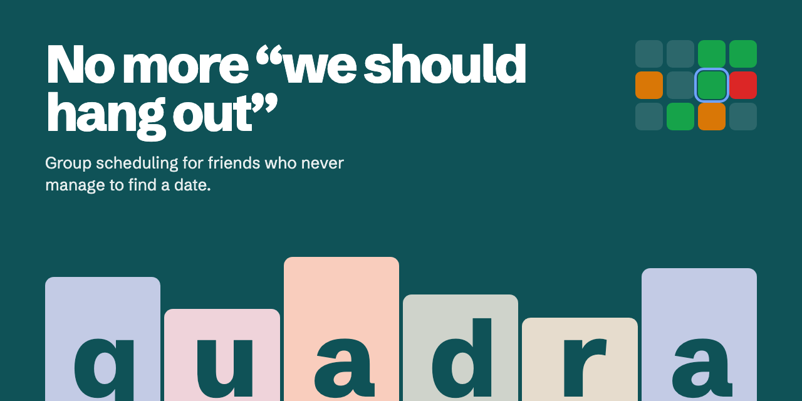
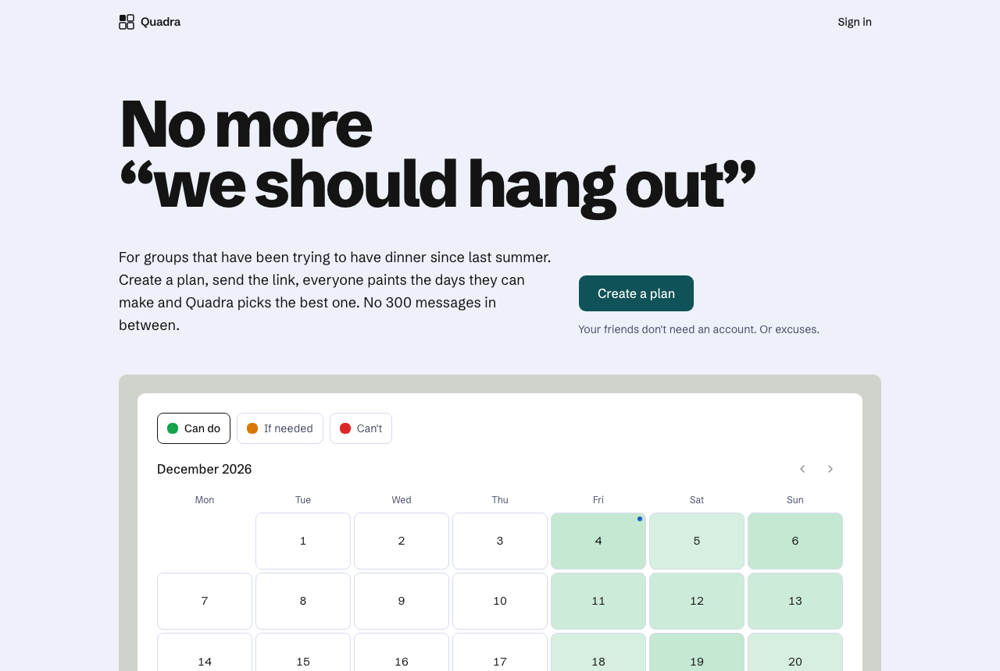
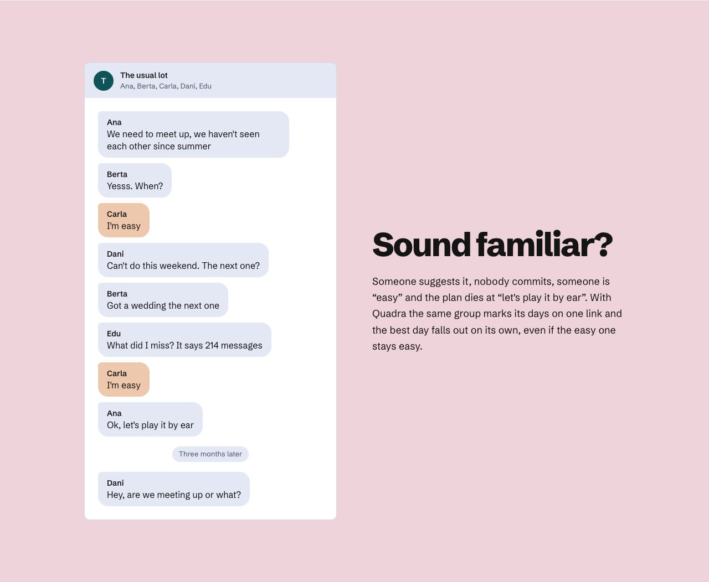
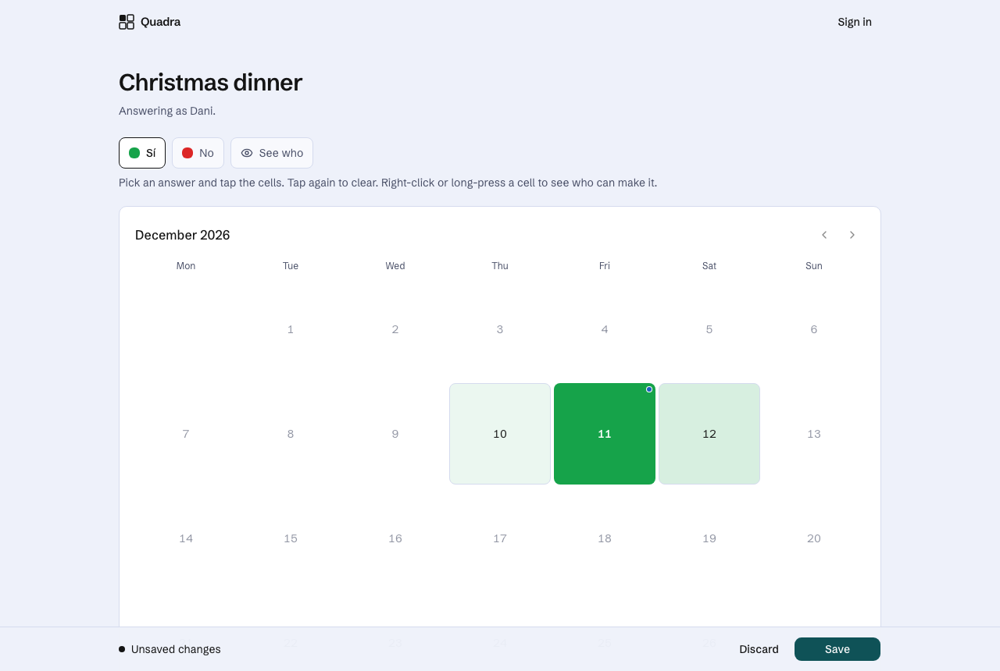
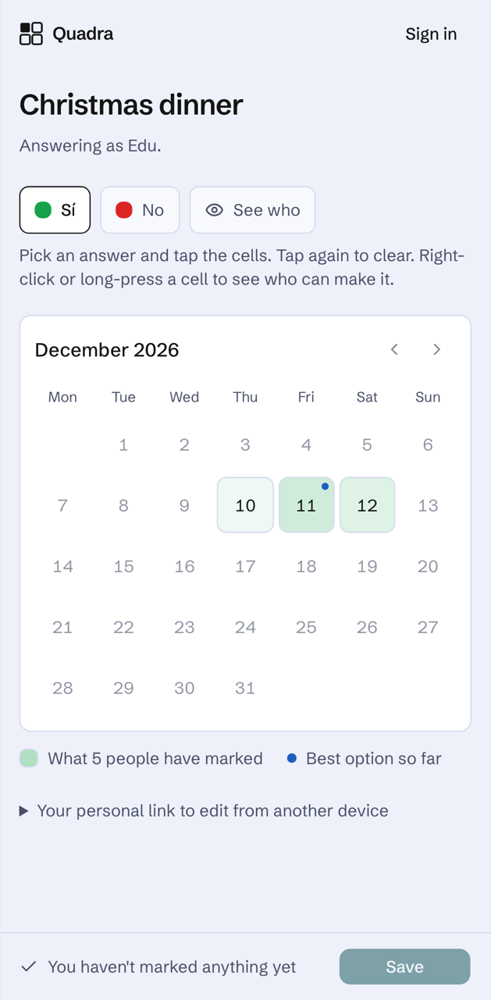
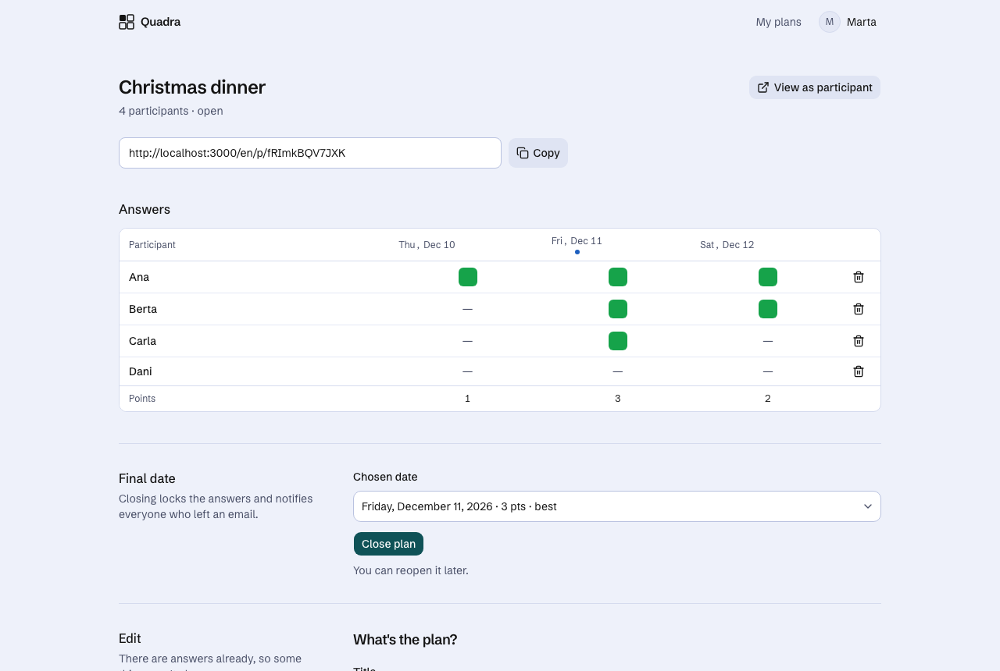

<p align="center">
  
</p>

**Quadra** is for the group chat that has been saying _“we should hang out”_ since last summer. Create a plan, send the link, everyone paints the days they can make, and Quadra picks the best one. Close it and everybody gets a calendar event. No 300 messages in between.

Your friends don't need an account. Or excuses.

<p align="center">
  
</p>

## Sound familiar?



Someone suggests it, nobody commits, someone is “easy” and the plan dies at “let's play it by ear”. With Quadra the same group marks its days on one link and the best day falls out on its own.

## Every group has one of each

| The friend                                      | What Quadra does about it                                                                                                |
| ----------------------------------------------- | ------------------------------------------------------------------------------------------------------------------------ |
| **The one who's “easy”**                        | Has to prove it: _Can do_, _If needed_ or _Can't_, painted day by day. Options, colours and weights are set by the plan. |
| **The one who signs up for nothing**            | Doesn't have to. Open the link, type a name, mark the days. A personal link lets them edit from another phone.           |
| **The “I can only do dinner” one**              | Plans can use whole days, named slots (_Lunch_, _Dinner_) or an hourly grid shown in each person's own time zone.        |
| **The one who'd rather nobody knew they can't** | The creator decides what guests see: who can make it, only the heatmap, or nothing at all.                               |
| **The one who hears about everything last**     | When the plan closes, everyone who left an email gets the date with an `.ics` for Google or Apple Calendar.              |

<table>
  <tr>
    <td width="68%"></td>
    <td width="32%"></td>
  </tr>
  <tr>
    <td colspan="2"></td>
  </tr>
</table>

Paint with a tap or drag across days. Right-click (or long-press on a phone) any cell to see who answered it.

## Run it locally

Requirements: Node 22+, pnpm 11, Docker.

```bash
pnpm install
cp .env.example .env.local   # then fill AUTH_SECRET (openssl rand -base64 32)
pnpm db:up                   # Postgres 17 on localhost:54329
pnpm db:migrate
pnpm dev                     # http://localhost:3000
```

Without `AUTH_RESEND_KEY`, magic links and notification emails are printed in the dev server console. Set `AUTH_TEST_LOGIN=1` locally for a one-click test login (never available in production).

## Scripts

| Script                                 | What it does                                                           |
| -------------------------------------- | ---------------------------------------------------------------------- |
| `pnpm dev`                             | Next.js dev server                                                     |
| `pnpm check`                           | Typecheck, lint, Prettier and unit tests (Vitest)                      |
| `pnpm test:e2e`                        | Playwright end-to-end tests, desktop and Pixel 7 (`next dev` on :3100) |
| `pnpm db:generate` / `pnpm db:migrate` | Drizzle migrations                                                     |
| `pnpm email:dev`                       | React Email preview of the templates                                   |

`SHOTS=1 pnpm exec playwright test e2e/screens.spec.ts` saves screenshots of every screen for a visual check.

## How it's built

- **Next.js 16** (App Router, Turbopack), **React 19**, TypeScript strict.
- **Auth.js v5**: Google and Resend magic link, JWT sessions. Guests never sign in; they get a cookie and a personal link.
- **Drizzle ORM** on Postgres: Neon in production, Docker locally.
- **next-intl**: Spanish (default), Catalan and English.
- **Tailwind v4 + shadcn/ui**. Design: pale periwinkle ground, ink type, one deep teal action, pastel fields per section. Colour on the calendar is reserved for answers. Typeface: Schibsted Grotesk.
- **React Email + Resend** for notifications; optional **Upstash** rate limiting.

The domain lives in `src/lib` (cells, grid, scoring, visibility), mutations in `src/server/actions`. See `PLAN.md` for the full spec.

## Deploying (Vercel)

1. Create a Neon database (Vercel Marketplace) and set `DATABASE_URL`.
2. Set `AUTH_SECRET`, `AUTH_GOOGLE_ID`, `AUTH_GOOGLE_SECRET`, `AUTH_RESEND_KEY`, `EMAIL_FROM`, `NEXT_PUBLIC_APP_URL` and, optionally, `UPSTASH_REDIS_REST_URL` / `UPSTASH_REDIS_REST_TOKEN` for rate limiting.
3. Google OAuth redirect URI: `https://<domain>/api/auth/callback/google`.
4. The build (`pnpm vercel-build`) applies migrations before `next build` when `DATABASE_URL` is present.

## Credits

The landing page's “People used to manage it” section uses public-domain pictures: _A Picnic Party_ (Claude Simpol, 1716), _A Picnic Party at Hagidera_ and _A Young Man, Two Young Women and a Girl at a Picnic Party_ (Katsukawa Shunchō, ca. 1789), all from The Metropolitan Museum of Art (CC0), and _Having fun at the Picnic Races Ball, Charleville_ (ca. 1950, State Library of Queensland, no known copyright restrictions).
